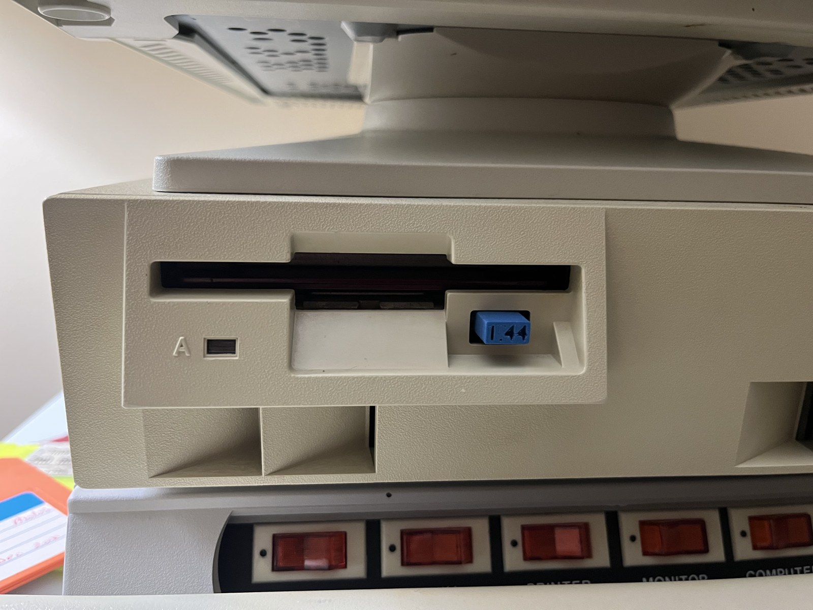

# IBM Floppy Button

3D-printable replacement button for the IBM 2121 floppy drive, with an engraved "1.44" label on the face.

## Files

- `IBM floppy button.blend`: Blender source
- `IBM floppy button.stl`: print-ready mesh
- `IBM floppy button.3mf`: slicer project
- `IBM floppy button_0.1mm_PLA_MK3S_19m.gcode`: sliced for a Prusa MK3S, 0.1 mm layers, PLA (about 19 minutes)

## Printing

- Filament: Overture Matte PLA, blue (close color match to the original)
- Layer height: 0.1 mm, so the small engraved text is legible

## License

[CC BY 4.0](https://creativecommons.org/licenses/by/4.0/). You can print, modify, and share this as long as you credit Graham Franz.

IBM and 2121 are used here only to identify the drive this part fits. This project is not affiliated with IBM.
